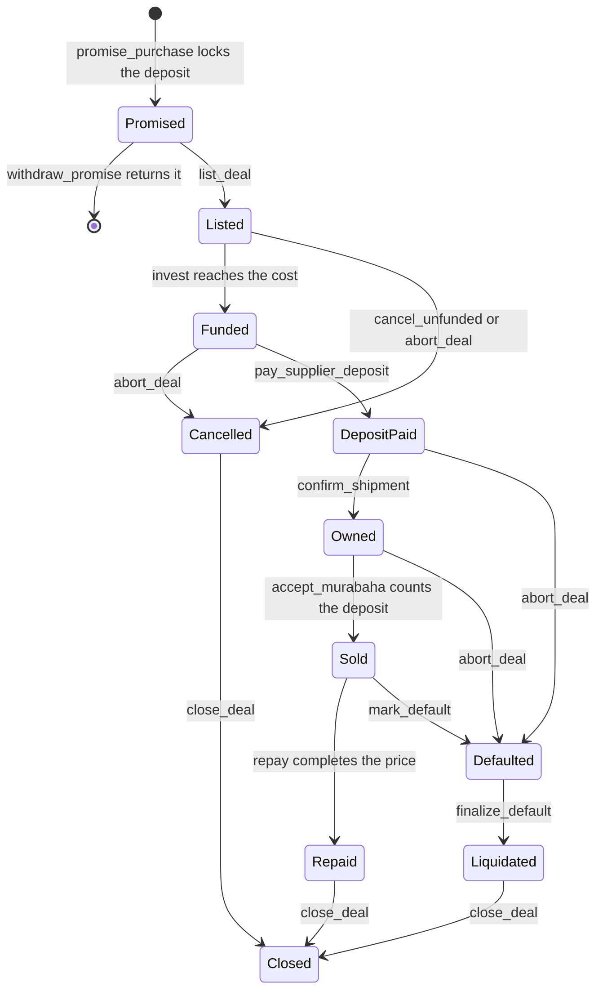

# Qafila: Flows, User Stories and v1.1 Changes

Version 1.1, Sunday 25 October 2026, 12:00. This file adds to `docs/PLAN.md`; where the two disagree, this file wins. Claude Code: build the MUST items in section 10 in order, then SHOULD items only when every MUST in PLAN.md is green.

PLAN.md sections this changes: 1.5 (lifecycle), 3.3.1 to 3.3.5 and 3.3.7 (contract), 3.4 (seed), 4.5 (faucet), 5.2 and 5.6 (consignee rule), 6 (agent), 8.1 and 8.5 (routes, notifications), 9.2 (screens), 16.2 and 19 (video, judge answers).

---

## 1. What changes

1. **The importer puts money in first.** When they sign the purchase promise they lock a security deposit (hamish jiddiyyah) in the contract: 20% of the cost on a first deal, 2.5 points less for each on-time deal, never below 10%. Nobody may use it while it is held.
   - The deal does not happen and it is not their fault: refunded in full.
   - They break the promise: only the actual loss is taken (cost minus what the goods are resold for), never lost profit; the rest comes back.
   - They buy the goods: it counts as their first payment of the price.

   They do not invest in their own deal: they would be on both sides of the sale.
2. **The importer vouches for their supplier.** If the supplier they chose takes the deposit and never ships, the importer's deposit covers the actual loss. The importer never carries loss or damage at sea or in storage: the investors own the goods then, and that risk is what makes their profit halal.
3. **Qafila really owns the goods before selling them.** The supplier sells to Qafila's deal entity, the bill of lading (B/L) is made out to Qafila's order with the importer as notify party, and the AI checks both before the balance is paid. Qafila releases the B/L to the importer once they sign the sale. The plan did not say this before. Without it, Qafila would only be paying the importer's bill, which is a loan with a markup (riba).
4. **A clear loss order:** the importer's money, then recoveries, then investors pro rata. Qafila invests 5% of every deal and loses alongside investors; its fee is earned only on repayment.
5. **Hardship gets time, never a higher price:** one extension per deal, price unchanged.
6. **Fixes found while writing this:**
   - Ops can stop a deal that is still `Listed`. Before, a red flag had to wait for the funding deadline.
   - Recoveries can never exceed what the importer owes.
   - Refunds are a separate pull, so a missing trustline never blocks a deal.
   - The testnet faucet gives approved importers enough test dollars for their deposit and repayment. Its 50 test dollars would not cover a deposit.

---

## 2. The Sharia basis

AAOIFI Shari'ah Standard No. 8 (Murabahah). Formal review by a Sharia board is still pending.

| Rule | Clause | In Qafila |
|---|---|---|
| A security deposit may be taken against a binding promise | 2/5/3 | `promise_purchase` locks it with the signed promise |
| On breach, only actual damage may be deducted: cost minus the resale price, not lost profit | 2/5/4 | `finalize_default` takes at most `funded - DealBalance` and refunds the rest |
| Once the customer buys, the deposit is refunded or, if agreed, deducted from the price | 2/5/5 | The promise says it counts as the first payment; `accept_murabaha` applies it |
| The customer may guarantee the supplier's performance in a separate capacity, never transit or storage risk | 2/5/1, 2/5/2 | Supplier guarantee in the promise; goods lost or damaged are never charged to the importer |
| No sale before the institution acquires the item; actual or constructive possession first; it bears the risk | 3/1/1, 3/2/1, 3/2/2 | Purchase from the supplier by Qafila's entity; B/L to Qafila's order; investors carry the risk until the sale |
| Late payment may carry an undertaking to donate; the money goes to charity, never to the institution | 5/6 | Fixed late fee, swept to the charity address |
| No extension in exchange for an extra payment | 5/7, 4/8 | `extend_due` cannot change the price |
| On default, the amount due is limited to the unpaid price | 5/8 | Recoveries are capped at what is still owed |
| An early-payment discount only if it was not part of the contract | 5/9 | No rebate in the terms |

The State Bank of Pakistan's murabaha essentials say the same on ownership risk, security, charity for late payment, no rollover and extension without a higher price. For the pitch: the Quran asks a creditor to give a debtor in hardship time until it is easier (2:280), and the extension does exactly that.

---

## 3. Who puts in what

| Party | Puts in | Gets back | Can lose |
|---|---|---|---|
| Importer | Security deposit at the promise; the rest of the price by the due date | The goods; the deposit in full if the deal does not happen through no fault of theirs | The deposit, up to the actual loss, if they break the promise or their supplier does not ship. After buying, they owe the full price whatever happens to their business |
| Investors | The cost of the goods, as shares 1:1 | Principal plus the markup minus the platform fee, pro rata | Up to their principal, and only after the importer's money and the recoveries |
| Qafila | 5% of every deal as an ordinary investor; screening and operations | Flat platform fee on repayment; profit on its 5% | Its 5%, and its fee on any deal not repaid |
| Supplier | The goods | Deposit before shipment (at most 30% of cost), balance once the shipment is confirmed | Nothing from Qafila |
| Charity | none | Late fees and rounding dust | none |

---

## 4. The full flow

| # | Step | Who | What happens | Money | State after |
|---|---|---|---|---|---|
| 1 | Sign up | Importer | Passkey wallet, company details, registration document (KYB) | none | none |
| 2 | Request | Importer | Supplier, goods, pro-forma invoice, packing list, supplier licence, tenor wanted | none | draft (off-chain) |
| 3 | Screening | AI, then ops | Documents checked against each other, the registry, sanctions, reference prices, the halal policy and the importer's limit | none | approve, review or reject |
| 4 | Purchase order | Qafila, supplier | Qafila's deal entity orders the goods; the supplier accepts and confirms the payout address (SHOULD: a link with an optional wallet signature) | none | PO accepted |
| 5 | Promise | Importer | Reads the promise in plain words (purchase promise, deposit rules, supplier guarantee, first-payment clause) and signs it with one passkey confirmation | importer to contract: security deposit | promise recorded on-chain |
| 6 | Listing | Ops | Share token issued; deal listed with the verifier's signature over the terms, deposit included | none | `Listed` |
| 7 | Funding | Investors, Qafila | Invest and receive locked shares; Qafila takes 5% | investors to contract: the cost | `Funded` |
| 8 | Supplier deposit | Agent | Pays the agreed supplier deposit | contract to supplier | `DepositPaid` |
| 9 | Shipment | Supplier, importer, agent | Goods ship to Qafila's order; the importer uploads the B/L; the AI checks it; the agent matches the carrier's loading event | contract to supplier: the balance | `Owned` |
| 10 | Sale | Importer | Signs the murabaha sale at the fixed price within the accept window; the deposit is counted as the first payment | the deposit joins the deal's balance | `Sold` |
| 11 | Release | Ops | Releases the B/L to the importer, who clears customs | none | `Sold` |
| 12 | Repayment | Importer | Pays the rest, in one or more instalments, by the due date | importer to contract | `Repaid` when the price is paid |
| 13 | Late fee (only if late) | Importer, agent | Pays the fixed late fee; the agent sweeps it to charity | importer to charity | `Repaid` |
| 14 | Payout | Investors, or the agent after 24 hours | Claims of principal plus profit pro rata; the fee goes to the treasury | contract to investors and treasury | `Closed` once all have claimed |

**Example, on time.** Cost 10,000; markup 800; platform fee 200; supplier deposit 30%; tenor 90 days; first deal, so the security deposit is 2,000.
- The importer locks 2,000. Investors put in 10,000, of which Qafila 500. The supplier receives 3,000, then 7,000.
- At the sale the price is 10,800 and 2,000 of it is already paid. The importer pays the other 8,800 by day 90.
- Investors receive 10,600: their 10,000 plus 600 profit, 6% in about 90 days. The treasury receives 200.

---

## 5. What happens if...

### 5.1 During screening (no money has moved)
| Situation | What happens |
|---|---|
| Company registration cannot be verified | The importer cannot request deals and sees which document is missing or wrong |
| A critical check fails: invalid check digit, closed company, sanctions match, prohibited goods, documents already financed | Rejected. The importer sees the category and what it means; the same files cannot be resubmitted; a sanctions match or a duplicate puts the account under review |
| Something needs a person: price far from the reference, small weight gap, unsure match, a data source down | Review: ops asks for an explanation or a document, the importer uploads it, screening runs again |
| Deal above the importer's limit | Screening says by how much; the importer splits the order or waits for an open deal to be repaid |
| Supplier rejects the purchase order, or the payout address does not match | Not listed until fixed; with `FF_SUPPLIER_CONFIRM` on, the agent never pays an unconfirmed supplier |
| Importer changes their mind before listing | `withdraw_promise` returns the deposit at once |

Nobody loses anything at this stage: the deposit is taken only after approval, and it is returned on request until the deal is listed.

### 5.2 Before the sale (the investors own the goods and the risk)
| Situation | What happens | Who loses | Contract calls |
|---|---|---|---|
| Funding not reached by the deadline | Cancelled; investors and the importer get 100% back; the importer may relist smaller | Nobody | `cancel_unfunded`, `claim`, `withdraw_refund` |
| Red flag after listing, before any payment | Ops stops the deal at once from `Listed` or `Funded`; everyone gets 100% back | Nobody | `abort_deal`, `claim`, `withdraw_refund` |
| Supplier takes the deposit and never ships | Ops aborts from `DepositPaid` and pursues the supplier. Under the supplier guarantee the importer's deposit covers the actual loss, unless ops records force majeure (port closed, war, sanctions on the route) | The importer's deposit, then investors. At most the supplier deposit is ever at risk here | `abort_deal(true)`, `deposit_recovery`, `finalize_default` |
| B/L does not match carrier tracking, or is not made out to Qafila's order | The balance is not paid; incident; supplier and importer asked to fix it; if they cannot, as above | As above | `abort_deal` |
| Goods lost or damaged at sea or in storage | The loss is the investors', as owners; cargo insurance (production) pays it as a recovery; the importer's deposit comes back in full | Investors (insured in production) | `abort_deal(false)`, `deposit_recovery`, `finalize_default` |
| Importer refuses to buy, or lets the accept window pass | Ops aborts with fault; Qafila holds the B/L and sells the goods elsewhere; the actual loss (cost minus the net resale price) comes from the deposit and the rest goes back; the importer is blocked | The importer's deposit up to the loss, then investors | `abort_deal(true)`, `deposit_recovery`, `finalize_default` |

**Example, supplier vanishes.** The supplier keeps the 3,000 deposit. The importer's 2,000 covers most of it: investors get 9,000 back (90%) instead of 7,000.

**Example, promise broken.** The supplier was paid 10,000; the importer refuses; Qafila resells for 9,000 net. The 1,000 loss comes from the 2,000 deposit and 1,000 goes back to the importer. Investors get 10,000 back with no profit, because lost profit cannot be charged.

### 5.3 After the sale (the importer owes a fixed price)
| Situation | What happens | Who loses | Contract calls |
|---|---|---|---|
| The importer sells the goods at a loss | Still owes the same price: that is their business risk | Importer | none |
| The local currency falls | The price is fixed in dollars, so the importer carries the currency risk; this is why tenors are short and the deposit is paid up front | Importer | none |
| Pays early | Allowed at the same price; investors are paid sooner; no rebate is promised | Nobody | `repay` |
| Genuine hardship before default | Ops grants one extension of up to 60 days (10 minutes on testnet); same price, no fee; late fee only after the new date. The deal then counts as neither on time nor late for the importer's limit and deposit | Investors wait longer, at no extra cost to the importer | `extend_due` |
| Pays late | Investors are paid in full as soon as the price is paid; the importer also owes the fixed late fee, which is swept to charity; their limit does not grow | Nobody | `repay`, `pay_late_fee`, `sweep_charity` |
| Defaults (due date plus grace passed) | Ops marks default and pursues recovery (legal claim, collection; in production also goods pledged to Qafila); recoveries can never exceed what is owed; investors share what is in the deal pro rata; the fee is forfeited; the importer is blocked | Investors, after everything the importer paid and the recoveries | `mark_default`, `deposit_recovery`, `finalize_default`, `claim` |
| Quality dispute after delivery | Between importer and supplier; the price does not change; Qafila provides the documents. Open point for the Sharia board: defect liability when the importer chose the goods | Importer, with recourse to the supplier | none |

**Example, default.** Same deal. The 2,000 deposit was counted at the sale; the importer then paid 3,000 more and defaulted with 5,800 outstanding. 2,500 is recovered (never more than 5,800). Investors get 2,000 + 3,000 + 2,500 = 7,500: 75% of their money, a 25% loss, Qafila's 500 included. The fee is 0. Without the deposit, the same payments would have meant a 45% loss.

### 5.4 Investors and the platform
| Situation | What happens |
|---|---|
| An investor wants out early | Not possible: shares are locked so a debt is never sold at a discount. Shown before investing; tenors are 60 to 120 days |
| An approved deal turns out to be fraud | Handled as above, depending on when it is found. The report hash on-chain shows exactly what was checked; the missed check joins the eval set; Qafila's 5% loses with everyone |
| Qafila disappears | The money is in the contract, not with Qafila: anyone can call `claim` for any holder and `withdraw_refund` for any importer, importers can still repay, and every deal's state is public |
| The verifier key is stolen | Pause and rotate the key; claims, refunds and sweeps keep working while paused |
| An investor loses their phone | Backup passkey (V-8) |

### 5.5 Loss order (shown on every deal page)
1. The importer's own money: the deposit, and after the sale everything they have paid.
2. Recoveries: from the supplier, insurance, resale of the goods, legal collection.
3. Investors pro rata, Qafila's own 5% included.

Qafila's fee is earned only when a deal is repaid. Nobody can lose more than they put in.

---

## 6. User stories

MUST stories are built now; SHOULD stories only after every MUST is green. NEW marks stories added in v1.1, CHANGED marks stories from PLAN.md that v1.1 changes.

### Importer
- **I-1 MUST.** As an importer, I want to sign up with a passkey and register my company, so that I can ask for financing without a crypto wallet. *Accept:* wallet in under 30 seconds; KYB form with registration document; "pending" until ops approves; on testnet, the faucet grant arrives on approval.
- **I-2 MUST.** As an importer, I want to submit a deal with my supplier's documents, so that Qafila can buy the goods for me. *Accept:* invoice, packing list and licence uploaded; terms prefilled from the invoice; draft saved.
- **I-3 MUST.** As an importer, I want the screening result in plain words with exactly what to fix, so that I can correct mistakes fast. *Accept:* each failed check names the document, the field and the fix; one document can be re-uploaded and screening re-run.
- **I-4 MUST.** As an importer whose deal was rejected, I want to know the category of the problem, so that I understand why. *Accept:* category shown (identity, sanctions, duplicate, prohibited goods, document integrity); identical files cannot be resubmitted.
- **I-5 MUST, NEW.** As an importer, I want to sign my purchase promise and lock my security deposit in one step, so that investors trust my commitment. *Accept:* before signing, the screen shows the amount and percentage, the three outcomes (full refund, actual loss only, first payment) and the supplier guarantee; one passkey confirmation; the deposit appears on the deal page with a stellar.expert link.
- **I-6 MUST, NEW.** As an importer, I want my deposit back in full when the deal does not happen through no fault of mine, so that I am not punished for things I do not control. *Accept:* "Withdraw" until listing pays back at once; after a cancel or a no-fault abort the amount appears under "Money to collect" and reaches my wallet (the agent sends it, or I tap).
- **I-7 MUST.** As an importer, I want to follow funding, supplier payments and the ship, so that I can plan the delivery. *Accept:* timeline of on-chain and carrier events; notifications at funded, deposit paid, shipment confirmed.
- **I-8 MUST, CHANGED.** As an importer, I want to sign the sale at the fixed price once Qafila owns the goods, so that I take ownership and can clear customs. *Accept:* price, already paid (my deposit), left to pay, due date and late-fee rule; accept-window countdown; one passkey confirmation; then the B/L release appears in the timeline (SHOULD, O-8).
- **I-9 MUST.** As an importer, I want to repay in instalments, so that I can pay as I sell. *Accept:* amount left shown; input capped at it; each payment with a transaction link.
- **I-10 MUST.** As an importer who paid late, I want to pay the late fee and see it reach the charity, so that the rule is transparent. *Accept:* late-fee card after a late final payment; the charity ledger shows the transaction.
- **I-11 SHOULD, NEW.** As an importer in genuine difficulty, I want to ask for more time without the price going up, so that I can recover without extra cost. *Accept:* request with a reason; ops decision recorded; new due date on-chain; price unchanged; once per deal.
- **I-12 SHOULD, NEW.** As a repeat importer, I want my deposit to fall as I repay on time, so that I lock up less cash as I grow. *Accept:* the dashboard shows the deposit my next deal needs (from `required_security`) and how it falls (2.5 points per on-time deal, never below 10%).
- **I-13 SHOULD.** As an importer, I want a trade file for my bank, so that I can justify the payment (S5).
- **I-14 SHOULD.** As an importer, I want my limit to grow with on-time repayments, so that I can finance bigger orders (S4).

### Investor
- **V-1 MUST.** As an investor, I want to join with a passkey in under 30 seconds, so that I can invest without a seed phrase or XLM.
- **V-2 MUST.** As an investor, I want to compare deals by goods, route, return, tenor, risk score, importer history and the importer's deposit, so that I can choose. *Accept:* all on the card; filter by tenor and risk.
- **V-3 MUST.** As an investor, I want to read the AI report and watch the ship, so that I can check the goods are real. *Accept:* checks with evidence; live carrier events; investors never see raw documents.
- **V-4 MUST.** As an investor, I want to see my expected profit and the risks before I confirm, so that I invest knowingly. *Accept:* expected profit; the loss order in three lines; "shares cannot be sold before the end"; amount capped at what is left to fund.
- **V-5 MUST, NEW.** As an investor, I want an "If things go wrong" box on every deal, so that the risk is plain. *Accept:* the importer's deposit (amount and %); the loss order; the worst case if the importer pays nothing after buying and nothing is recovered (you get back the deposit's share, `security / cost`); Qafila's 5% stake; "the fee is earned only on repayment". All numbers come from this deal.
- **V-6 MUST.** As an investor, I want my money back automatically when a deal is repaid, cancelled or wound up, so that I do not have to watch it. *Accept:* "Claim" button; the agent claims for me after 24 hours; notification with the amount.
- **V-7 SHOULD, NEW.** As an investor in a deal that went wrong, I want a timeline of what Qafila is doing and what has been recovered, so that I am not left guessing. *Accept:* each recovery with amount and transaction; dated ops notes; final amount shown before I claim.
- **V-8 SHOULD.** As an investor, I want to add a backup passkey, so that losing my phone does not lock me out.
- **V-9 SHOULD, NEW.** As an investor, I want a warning when one deal would be more than 25% of my portfolio, so that I spread my risk.

### Supplier
- **S-1 SHOULD, NEW.** As a supplier, I want to accept Qafila's purchase order and confirm my payout address through a link in English and Chinese, so that nobody can redirect my payment. *Accept:* no account needed; acceptance recorded with the time; the agent will not pay an unconfirmed supplier when the flag is on.
- **S-2 SHOULD, NEW.** As a supplier with a Stellar wallet, I want to sign a message with my payout account, so that I prove I control it. *Accept:* signature checked against the payout address and stored.
- **S-3 MUST.** As a supplier, I want to see both payments, so that I know when to ship. *Accept:* the public deal page shows the deposit and the balance with transaction links (already in PLAN 9.2).

### Ops and Sharia board
- **O-1 MUST.** As ops, I want a queue of deals with evidence highlighted, so that I can review fast.
- **O-2 MUST.** As ops, I want to override a decision with a written reason, so that every exception is auditable.
- **O-3 MUST.** As ops, I want to list a deal in one click, so that the factory, attestation and listing run in order.
- **O-4 MUST.** As ops, I want to pay the supplier deposit when the agent has not, so that deals do not stall.
- **O-5 MUST, CHANGED.** As ops, I want to stop or abort a deal with a reason from a fixed list, so that money is never stuck and the deposit is used fairly. *Accept:* reasons are red flag before payment, supplier did not ship, B/L mismatch not fixed, importer refused or let the window pass, goods lost or damaged, force majeure, other. "At fault" follows from the reason (supplier did not ship: yes unless force majeure; importer refused: yes; goods lost: no), and changing it needs a note. Every abort is logged for the Sharia board.
- **O-6 MUST.** As ops, I want to mark a default, record recoveries with notes and finalize, so that investors are paid what is left.
- **O-7 SHOULD, NEW.** As ops, I want to extend a due date once without changing the price, so that importers in hardship get time.
- **O-8 SHOULD, NEW.** As ops, I want to record the B/L release after the sale, so that the hand-over of the goods is on the record.
- **B-1 SHOULD.** As the Sharia board, I want to edit the halal goods policy, so that screening follows our rulings.
- **B-2 SHOULD, NEW.** As the Sharia board, I want to review every at-fault decision and every use of a deposit, so that deposits are only taken for real loss.
- **B-3 SHOULD.** As the Sharia board, I want a read-only auditor view of all deals and the charity ledger, so that I can audit every year.

### Agent and external lender
- **A-1 MUST.** The agent pays the supplier deposit on a funded deal only when the registry and sanctions checks passed, no incident is open and, with the flag on, the supplier accepted the purchase order.
- **A-2 MUST.** The agent confirms a shipment only when the carrier's loading event matches the B/L and the B/L is made out to Qafila's order.
- **A-3 MUST.** The agent sweeps late fees to charity, sends refunds after every `refund_owed` event, claims for investors after 24 hours and closes finished deals.
- **L-1 SHOULD.** Another lender's agent buys a verification over x402 and checks its signature on-chain (S1).

---

## 7. Deal states



`Promised` is the promise record, not a `DealState`. Calls that keep the state (`repay` before the last payment, `extend_due`, `deposit_recovery`, `claim`, `withdraw_refund`) are left out of the diagram.

---

## 8. Contract delta (Track A)

Naming: the importer's money is `security` in code and "security deposit" in the UI, so it never mixes with the supplier deposit (`deposit_bps`, `pay_supplier_deposit`) or with recoveries (`deposit_recovery`).

**Types**
```rust
pub struct Config {
    // ...existing fields...
    pub min_security_bps: u32,    // 2000: first deal
    pub security_step_bps: u32,   // 250: less per on-time deal
    pub security_floor_bps: u32,  // 1000: never below
    pub max_extension_secs: u64,  // 600 on testnet, 60 days on mainnet
}
pub struct DealTerms { /* ...existing fields... */ pub security: i128 }
pub struct Deal { /* ...existing fields... */ pub security: i128, pub importer_at_fault: bool, pub extended: bool }
pub struct PromiseRecord { pub importer: Address, pub promise_hash: BytesN<32>, pub security: i128, pub at: u64, pub listed: bool }
```

**Storage:** persistent `Refund(Address) -> i128`; instance totals `PromiseHeld: i128` (security held in unlisted promises) and `RefundsOwed: i128`.

**Errors:** `SecurityTooLow`, `SecurityTooHigh`, `PromiseExists`, `PromiseListed`, `NothingToRefund`, `InvalidDueDate`, `AlreadyExtended`.

**Rule:** `required_security(importer, cost) = ceil(cost * max(security_floor_bps, min_security_bps - on_time * security_step_bps) / 10000)`, with saturating `u32` subtraction and multiplication and checked `i128` math.

**"Refund the security"** below means: `Refund(importer) += security`, `RefundsOwed += security`, `security = 0`, emit `refund_owed(importer, amount)`.

**Changed functions**

| Function | Change |
|---|---|
| `promise_purchase(importer, listing_fingerprint, promise_hash, security)` | `security > 0`; `ImporterInDefault` if the importer has a default; `PromiseListed` if the fingerprint is already listed; `PromiseExists` if an unlisted promise exists (withdraw it first); transfers `security` from the importer; `PromiseHeld += security`; emits `promised` with the amount |
| `list_deal` | Also: `terms.security == promise.security`; `terms.security >= required_security(importer, cost)`, else `SecurityTooLow`; `terms.security < cost`, else `SecurityTooHigh`; `deal.security = terms.security`; `PromiseHeld -= security`; `promise.listed = true`. The LIST attestation now covers the deposit because it is part of `DealTerms` |
| `abort_deal(deal_id, importer_at_fault)` | Now also from `Listed`, with the same effects as from `Funded` (`Cancelled`), so ops can stop funding at once. From `Listed` or `Funded`: refund the security. From `DepositPaid` or `Owned`: store `importer_at_fault`; if false, refund the security now; if true, keep it for `finalize_default` |
| `cancel_unfunded` | Refund the security |
| `accept_murabaha` | After `sale_price` is set: `principal_repaid = security`, `DealBalance += security`, `security = 0`; emits `security_applied` |
| `repay` | At completion, if `extended`: `late += 1` only if paid after the new due date; otherwise neither `on_time` nor `late` changes |
| `deposit_recovery` | If the deal was sold (`sale_price > 0`): `principal_repaid + recovered + amount <= sale_price`, else `ExceedsRemaining` |
| `finalize_default` | First, if not sold and `security > 0`: `loss = max(0, funded - DealBalance)`, `used = min(security, loss)`, `DealBalance += used`, refund `security - used`, emit `security_used(amount)`. Then as before |
| `pause` | `withdraw_promise` and `withdraw_refund` also work while paused |

**New functions**

| Function | Auth | When | Effect |
|---|---|---|---|
| `withdraw_promise(importer, listing_fingerprint)` | importer | promise exists and is not listed | Pays the security back at once; `PromiseHeld -= security`; deletes the promise; emits `promise_withdrawn` |
| `withdraw_refund(addr)` | anyone (it pays `addr`) | `Refund(addr) > 0`, else `NothingToRefund` | Transfers it to `addr`; zeroes it; `RefundsOwed -= amount`; emits `refunded` |
| `extend_due(deal_id, new_due_at)` | admin | `Sold`; not `extended` (else `AlreadyExtended`); `due_at < new_due_at <= due_at + max_extension_secs` (else `InvalidDueDate`) | Sets `due_at`; `extended = true`; `sale_price` untouched; emits `due_extended` |
| Views `required_security(importer, cost)`, `refund_of(addr)` | anyone | any | Read only |

**Invariants** (replace 1, add 11 to 15)
1. Sum of `DealBalance` + sum of `Deal.security` + `PromiseHeld` + `RefundsOwed` + `CharityOwed` + `TreasuryOwed` equals the contract's settlement-token balance.
11. A deposit is used only for an actual loss before the sale (`used <= funded - DealBalance`); the excess always goes back to the importer.
12. For a sold deal, `principal_repaid + recovered <= sale_price`: the importer never pays more than the price.
13. `extend_due` never changes `sale_price` and runs at most once per deal.
14. Refunds only ever go to the deal's importer.
15. `security == 0` in every terminal state.

**Tests** (add to 3.3.7; the amounts are the worked examples in sections 4 and 5)
- Promise locks the deposit; a second promise on the same fingerprint fails; withdraw before listing returns it; withdraw after listing fails; a promise while in default fails.
- Listing below `required_security` fails, exactly at it passes, `security >= cost` fails; after two on-time deals the requirement is 15%; it never goes below 10%.
- Cancel, and abort from `Listed` and `Funded`, refund the deposit; `withdraw_refund` pays a C address and a G address, and anyone can trigger it.
- On time: the deposit counts at the sale; the importer pays 8,800; holders get 10,600 and the treasury 200.
- Supplier vanishes (`DepositPaid`, at fault): holders get 9,000; nothing is refunded.
- Promise broken (`Owned`, at fault, resale 9,000): 1,000 used, 1,000 refunded, holders get 10,000.
- Goods lost (`Owned`, not at fault): the full deposit is refunded at abort.
- Sold default: holders get 7,500; a recovery above the 5,800 outstanding fails with `ExceedsRemaining`.
- `extend_due`: once only; price unchanged; a payment before the new date is not late and does not count as on time.
- Pause: `withdraw_promise` and `withdraw_refund` still work.
- Proptest invariant 1 over random sequences that include promises, withdrawals, cancels, aborts and refunds.

**Deployment**
- `DealTerms` changed, so regenerate the golden vectors and the TypeScript bindings and make SP11 pass again.
- If the contract is not on testnet yet, build this in from the start. If it is, deploy a fresh instance, update `deployments/testnet.json` and `deployments/testnet-e2e.json`, let `GET /config` serve the new id and seed again. Once the venue join has started, never redeploy without Ilyes saying so (positions would be lost).
- The deploy script sets the four new config values and creates a co-invest account on testnet (friendbot, qUSD trustline, minted qUSD, `approve_investor`).

---

## 9. API, agent and web delta

**API and agent (Track B)**
- `POST /deals/:id/promise` also returns `security` (simulate `required_security`) and the promise text from a versioned template in `packages/shared/src/promise.ts`: purchase promise, deposit rules, supplier guarantee, first-payment clause.
- Shipment-stage pipeline: the commercial invoice's buyer and the B/L's consignee must be Qafila's deal entity ("Qafila Trade, deal <number>", or "to order of" it) and the notify party the importer; otherwise **review**, and the agent never confirms a shipment under review. This is what "consignee matches the deal structure" in PLAN 5.2 means. Update the demo packets and the eval expectations (still 12 of 12). The real importer's past shipment will show "review: consignee is the importer", which is honest: that deal did not go through Qafila.
- `POST /ops/deals/:id/abort` takes a reason from O-5's list and sets `importer_at_fault` from it; a change needs a note; audit log.
- Agent: A-1 to A-3 above.
- Faucet (testnet): when ops approves an importer's KYB, one grant of 1.35 times the importer's limit in test dollars (deposit plus the full price at the markup cap), so a live importer can lock the deposit and repay.
- Seed: every demo deal uses `required_security`; the co-invest account takes 5% of each (`COINVEST_BPS`); the late deal's importer can repay.
- Notifications: deposit refunded, deposit used (amount and reason), due date extended.
- `GET /stats`: add importer deposits locked and refunds paid.
- SHOULD: `POST /deals/:id/extension-request` (importer) and `POST /ops/deals/:id/extend` (ops); `GET /deals/:id/purchase-order`; `GET` and `POST /supplier/confirm/:token`, with an optional signed message checked against the payout address (S-1, S-2).

**Web (Track C)**
- Promise step (I-5): amount and percentage, why there is a deposit (two lines), the three outcomes, the supplier guarantee, then one passkey confirmation.
- "If things go wrong" box on deal pages (V-5).
- Sign-sale screen (I-8): already paid, left to pay, due date.
- "Money to collect" card for importers (I-6).
- Ops: abort reason picker (O-5); recovery notes (O-6).
- Playwright: the happy path now locks the deposit at the promise and shows it counted at the sale; a cancelled deal refunds it.
- SHOULD: extension request and ops extend (I-11, O-7), next deposit on the importer dashboard (I-12), recovery timeline (V-7), concentration warning (V-9), supplier page in English and Chinese (S-1, S-2), B/L release record (O-8).

**Environment (add to `.env.example`)**
```
MIN_SECURITY_BPS=2000
SECURITY_STEP_BPS=250
SECURITY_FLOOR_BPS=1000
MAX_EXTENSION_SECS=600              # testnet; 5184000 (60 days) on mainnet
COINVEST_BPS=500
COINVEST_SECRET=                    # testnet only, created by the deploy script
QAFILA_ENTITY_NAME=Qafila Trade
FF_SUPPLIER_CONFIRM=false           # true once S-1 works
FF_EXTENSIONS=true
FF_COINVEST=true
```

---

## 10. Order of work for the rest of the hackathon

It is about H3. Track A starts the full contract at H4 (13:00), so section 8 costs little if it goes in before then.

| # | Item | Track | Time | Tier |
|---|---|---|---|---|
| 1 | Contract delta with its tests, golden vectors, bindings | A | about 1.5 h inside H4 to H9 | MUST |
| 2 | Deploy-script config and co-invest account; seed with deposits and the 5% co-invest | A | 30 min | MUST |
| 3 | Promise text and `security` in the promise route; importer faucet grant; abort reasons | B | 1 h | MUST |
| 4 | Buyer and consignee check; demo packets and eval updated; agent rules A-1 to A-3 | B | 1 h | MUST |
| 5 | Promise step, "If things go wrong" box, sign-sale amounts, "Money to collect", abort picker, Playwright | C | 2 h | MUST |
| 6 | Extension: API and UI (the contract part is in item 1) | B, C | 45 min | SHOULD |
| 7 | Supplier purchase order and confirmation page | B, C | 1.5 h | SHOULD |
| 8 | Next deposit on the dashboard, recovery timeline, concentration warning, B/L release record | C | 1 h | SHOULD |

The cut rule in PLAN 14.1 still applies at H12: if the happy path is not green end to end, SHOULD items wait.

**Roadmap (deck only, not built):**
- Goods pledged to Qafila after the sale until paid (AAOIFI 5/2).
- The electronic B/L handed to the importer in the same transaction as the sale.
- A mutual protection pool (takaful) funded by donations from each deal.
- A secondary market while a deal still owns the goods.
- Auto-invest.

---

## 11. What to say

- **Pitch line:** "The importer puts 20% in before the goods leave the factory. If they or their supplier let investors down, the importer's money goes first."
- **Video, 1:30 to 1:55:** "The deposit counts as the importer's first payment; profit from trade, not time; late fees go to charity."
- **Replace PLAN 19, "What if the importer does not pay?":** "They have already paid 20% before the goods ship, and that money is lost first. Then come recoveries, then investors pro rata, with Qafila's own 5% losing alongside them. Our fee is earned only on repayment. Limits start small, and deposits fall only with on-time repayment."
- **Add to PLAN 19, "How do you own the goods?":** "The supplier sells to Qafila's deal entity and the bill of lading is made out to our order. The AI checks both before the contract pays the balance, and we hand the bill of lading over only when the importer signs the sale."
- **Add to PLAN 19, "What if the importer is struggling?":** "We give them time once, and the price never goes up. The murabaha standard forbids charging for extra time, and the Quran asks creditors to give a debtor in hardship time (2:280)."

---

## 12. Prompts

**Main session, first (2 minutes, in the main repo)**
```
docs/FLOWS.md has been added. In CLAUDE.md change "The full specification is `docs/PLAN.md`." to "The full specification is `docs/PLAN.md`, with v1.1 changes in `docs/FLOWS.md`; where they disagree, FLOWS.md wins." Apply FLOWS.md section 11 to PLAN.md sections 16.2 and 19. Commit "docs: flows v1.1" on main and push.
```

**Track A**
```
Commit your work, then run `git merge main` to get docs/FLOWS.md and read all of it. Section 8 is now part of M1. Finish the spike you are on. Then build qafila_deals with section 8 included from the start (or add it now if the contract is already written): every changed and new function, the updated invariants as proptests and every test listed. Regenerate the golden vectors and bindings (DealTerms changed) and make SP11 pass again. Follow the deployment notes in section 8 and item 2 of section 10. Add the new values to .env.example. Update docs/PROGRESS.md and commit after every green step.
```

**Track B**
```
Commit your work, then run `git merge main` to get docs/FLOWS.md and read sections 5, 6, 8 and 9. After your current step, do Track B's MUST items in section 10 in order (items 3 and 4). Keep pnpm eval at 12 of 12 with the updated packets. Use the new bindings once Track A pushes them; until then code against the interface in section 8. SHOULD items only when every MUST is green. Update docs/PROGRESS.md and commit after every green step.
```

**Track C**
```
Commit your work, then run `git merge main` to get docs/FLOWS.md and read sections 4, 5, 6 and 9. After your current screen, build item 5 of section 10. Every amount comes from the contract or the API, never hard-coded, and copy follows CLAUDE.md. SHOULD items only when every MUST is green. Update docs/PROGRESS.md and commit after every green screen.
```

---

## 13. Sources
- AAOIFI Shari'ah Standard No. 8, Murabahah (clauses 2/5/1 to 2/5/5, 3/1/1, 3/2/1, 3/2/2, 4/8, 5/2, 5/6 to 5/9): https://pkic.com/wp-content/uploads/2025/07/SS-8-Murabahah.pdf
- Fincyclopedia, Security deposit in murabaha: https://fincyclopedia.net/tutorials/islamic-finance-tutorials/security-deposit-in-murabaha/
- State Bank of Pakistan, Shariah Board essentials of Islamic modes of financing (murabaha clauses 1(iii), 1(viii), 1(x), 1(xi)): https://www.sbp.org.pk/press/Essentials/Essentials%20of%20Islamic.htm
- Quran 2:280: https://quran.com/2/280